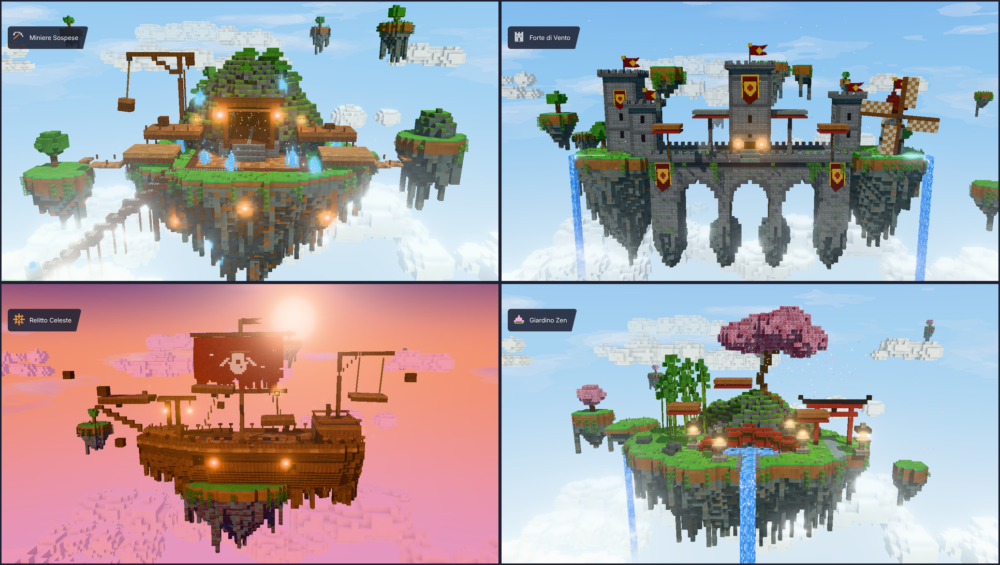

# Isole Voxel — 4 mappe 3D fluttuanti con VFX

Quattro mappe 3D in stile voxel (isole sospese nel cielo), con animazioni ed effetti in tempo reale,
costruite in [three.js](https://threejs.org). Ogni mappa è generata da codice blocco per blocco ed è
esportabile come modello `.glb`.



| Mappa | Contenuto | Animazioni / VFX |
|---|---|---|
| ⛏️ **Miniere Sospese** | isola rocciosa, collina muschiosa con ingresso della miniera, impalcature in legno, gru, binari su traliccio, ponti di assi verso isole satellite | cassa che oscilla appesa alla gru, carrello che percorre i binari, cristalli luminosi con scintille, polvere che esce dalla miniera, polline, lanterne che tremolano |
| 🏰 **Forte di Vento** | ponte ad archi tra due rupi, mastio centrale, torri con merli, mulino a vento, piattaforme con bordo rosso laccato | pale del mulino che girano, bandiere e stendardi che sventolano, due cascate, raffiche di vento, foglie trasportate dal vento |
| ☸️ **Relitto Celeste** | nave volante distrutta al tramonto, scafo con chiglia scheggiata, albero maestro, castello di poppa, forca con lanterne | vela strappata che si gonfia, piattaforma che dondola sulle corde, detriti e piattaforme che galleggiano, la nave che rolla, braci e schegge che cadono |
| 🪷 **Giardino Zen** | grande ciliegio in fiore su una rupe, bambù, laghetto con ninfee, ponte rosso ad arco, torii, lanterne di pietra | petali che cadono, bambù che ondeggia, acqua del laghetto che scorre, cascata principale e sorgente laterale, scintillii, farfalle, piattaforme fluttuanti |

Effetti comuni a tutte le mappe: cielo con gradiente e nuvole dipinte in movimento, nuvole voxel che
scorrono, mare di nuvole sotto le isole, isole lontane che fluttuano sullo sfondo, nebbia atmosferica,
bloom sui materiali emissivi, ombre in tempo reale, vegetazione mossa dal vento.

## Avvio

```bash
npm install
npm run dev        # http://localhost:5173  (?map=mines | fort | wreck | zen)
npm run build      # sito statico in dist/ (funziona anche da sottocartella, es. GitHub Pages)
```

Comandi: trascina per ruotare, rotella per lo zoom, tasto destro per spostare la vista.
Pulsanti: auto-rotazione, **Esporta GLB** (scarica la mappa corrente), screenshot PNG.

## Modelli 3D (.glb)

I modelli già esportati sono in [`models/`](models/): `mines.glb`, `fort.glb`, `wreck.glb`, `zen.glb`.
Contengono le mesh voxel (con AO nei colori dei vertici e atlas delle texture), bandiere/vele, cascate e le
parti animate come nodi separati (`crane_crate_pivot`, `minecart_pivot`, `windmill_sails_pivot`,
`swing_platform_pivot`, `bamboo_pivot_*`…), così si possono riprendere in Blender, Unity, Godot o Roblox Studio.
Le particelle e il cielo sono solo per il browser e non vengono esportati.

Per rigenerarli (con `npm run dev` attivo e Playwright installato):

```bash
npm run export:glb   # scrive models/*.glb
npm run shots        # scrive screenshots/*.png
```

## Struttura

```
src/
  engine/   atlas texture, registro blocchi, texture procedurali pixel-art, mesher voxel (AO, culling), materiali animati
  vfx/      cielo, nuvole voxel, cascate e superfici d'acqua, particelle GPU
  maps/     common.js (isole fluttuanti, lanterne, stoffe che sventolano, isole di sfondo) + una mappa per file
public/textures/kenney-voxel/   texture scaricate (CC0)
models/                         export .glb
scripts/                        export GLB e screenshot automatici (Playwright)
```

## Asset: ricerca e licenze

- **Texture dei blocchi, cielo e particelle:** [Kenney — Voxel Pack](https://kenney.nl/assets/voxel-pack)
  (CC0 1.0, licenza in `public/textures/kenney-voxel/LICENSE.txt`). Scaricate dal mirror GitHub completo
  della libreria Kenney [shorepine/kenney](https://github.com/shorepine/kenney), perché da questo ambiente
  kenney.nl, OpenGameArt, itch.io, Poly Haven e ambientCG non sono raggiungibili.
  Sono usate per terra, erba, pietra, minerali, tronchi, acqua, binari e funghi.
- **Texture procedurali** (`src/engine/procTextures.js`): mattoni del castello, assi di legno, foglie di
  ciliegio, bambù, lacca rossa, cristalli, lanterne, grate, tegole, fiori, ninfee e altri blocchi che il Voxel Pack
  non copre. Sono generate pixel per pixel in 16×16 per restare nello stile voxel.
- **Mesh:** tutte le strutture sono voxel generati da codice, per avere uno stile coerente in tutte le mappe.
  Ho valutato i kit 3D CC0 di Kenney (Castle, Pirate, Nature…), ma sono low-poly e non voxel.
- Altre fonti CC0 valutate e non usate: [Auseawesome/Minecraft-Textures](https://github.com/Auseawesome/Minecraft-Textures)
  (soprattutto oggetti e gemme, pochi blocchi utili), i pacchetti 16×16 su OpenGameArt (sito non raggiungibile da qui).

Codice: three.js (MIT). Stile ispirato alle mappe voxel dei giochi "steal-a-…" su Roblox. Le mappe sono
originali e non usano asset di quei giochi.
